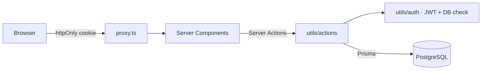

<div align="center">

# 🏥 Hospital Management System

### One system for patients, doctors, appointments, admissions and the hospital pharmacy

        

**[📦 Source](https://github.com/n1j10/hospital-mangmeant-system)**

</div>

---

## ✨ Overview

A role-based hospital information system (**Admin · Receptionist · Doctor**) that covers the full patient journey: registration, appointment, consultation and prescription, then admission and discharge. It also tracks pharmacy stock with low-stock and expiry alerts.

## 🧩 Modules

| Module | Highlights |
| --- | --- |
| 📊 Dashboard | Live stats, today's appointments, role-aware notifications |
| 🧑‍🤝‍🧑 Patients | Registration, profile, full medical history |
| 👨‍⚕️ Doctors & Departments | Specialities, per-department view |
| 📅 Appointments | Booking and status workflow; doctors see only their own appointments |
| 🩺 Consultations | Diagnosis notes and prescriptions linked to pharmacy stock |
| 🛏️ Admissions | Admit and discharge workflow |
| 💊 Pharmacy | Medicines, categories, **low-stock** and **expiring** reports |
| 👤 Users | Admin user management, profile page |

## 🏗️ Architecture



## 🔐 Security

Security was designed in from the start:

| Area | Implementation |
| --- | --- |
| Sessions | JWT signed with HS256 (algorithm pinned) in an **httpOnly, Secure, SameSite** cookie. Token and cookie share the same 7-day lifetime |
| Password storage | Salted **scrypt** (a memory-hard KDF). Older hashes are verified in constant time and **upgraded automatically at login** |
| Secret management | No hard-coded signing key; it comes from the environment |
| Authorization | Every request reloads the user from the database, so deleted or demoted accounts lose access immediately |
| Privilege escalation | Self-registration as ADMIN only works on a fresh install with no admin. After that, only an admin can create admins |
| Server Actions | Caller-supplied identity is never trusted; the user always comes from the session |
| Validation and headers | Zod on every form; HSTS, `X-Frame-Options`, `nosniff`, `Referrer-Policy` |

> Secrets are stored only in environment variables. `.env*` is git-ignored, and `.env.example` contains placeholders only.

## 🛠️ Tech Stack

Next.js 16 (App Router, Server Actions) · React 19 · TypeScript · Prisma · PostgreSQL · jsonwebtoken · Zod · Tailwind CSS v4 · shadcn/ui

## 🚀 Getting Started

```bash
# 1. Install
npm install

# 2. Configure environment
cp .env.example .env        # fill in the values

# 3. Database
npx prisma migrate deploy   # or: npx prisma db push

# 4. Run
npm run dev                 # http://localhost:3000
```

## ☁️ Deployment

Deployed on **Vercel**. Add the variables from `.env.example` under *Project → Settings → Environment Variables*, then push. Vercel builds and deploys automatically.

Generate a strong `JWT_SECRET` with `openssl rand -base64 48`.

## 👤 Author

**n1j10**, full-stack engineer (Next.js · TypeScript · Node.js · PostgreSQL)

[](https://github.com/n1j10)

> If you find this project useful, a ⭐ on the repo is appreciated.
